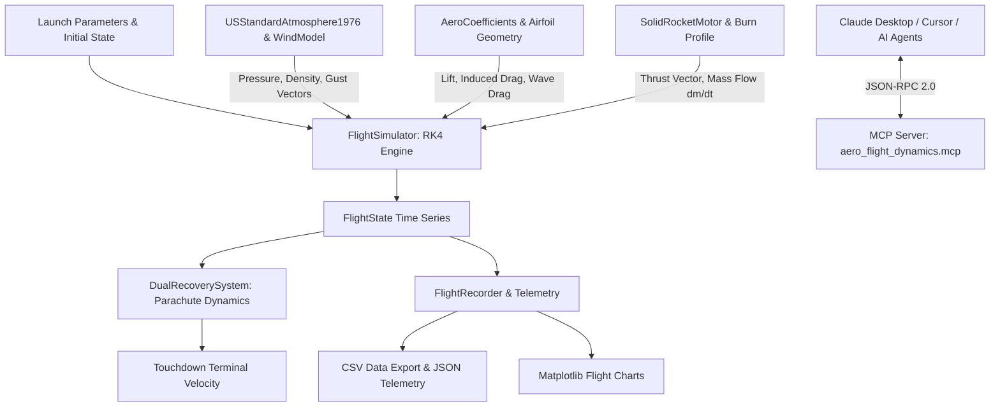

# aero-flight-dynamics

[](https://github.com/perfectalone375/aero-flight-dynamics/actions)
[](https://opensource.org/licenses/MIT)
[](https://www.python.org/downloads/)
[](deliverables/mcp_integration_guide.md)
[](https://github.com/astral-sh/ruff)
[](tests/)

**`aero-flight-dynamics`** is an open-source, high-fidelity computational aerospace library and **Model Context Protocol (MCP) Server** in Python. It provides rigorous thermodynamic atmosphere models, compressible aerodynamics, solid rocket propulsion physics, 3-DoF Runge-Kutta 4th-order (RK4) trajectory integration, dual-deployment parachute recovery dynamics, and automated flight telemetry analytics.

---

## Architecture Overview



---

## Core Capabilities

### 1. Model Context Protocol (MCP) Server
* Exposes live aerospace dynamics tools directly to AI coding assistants (**Claude Desktop**, **Cursor**, **Windsurf**, and **Antigravity**).
* Provides automated tools for 3-DoF trajectory simulation, 1976 standard atmosphere calculations, NACA airfoil evaluation, and parachute landing velocity estimates.
* See [deliverables/mcp_integration_guide.md](deliverables/mcp_integration_guide.md) for quick setup.

### 2. 1976 U.S. Standard Atmosphere & Wind Shear Model
* Exact implementation of the 7-layer atmospheric model up to 86,000 meters geopotential altitude.
* Evaluates hydrostatic pressure, temperature lapse rates, density, sound speed, and Sutherland dynamic viscosity.
* MIL-F-8785C compliant boundary layer wind shear and "1 - cosine" discrete atmospheric gust models.

### 3. Compressible Aerodynamics & Transonic Wave Drag
* **Airfoil Modeling:** NACA 4-digit parametric airfoil geometry generator (mean camber line, thickness distribution, theoretical lift curve slope).
* **Compressibility Corrections:** Prandtl-Glauert subsonic compressibility correction ($C_L = C_{L0} / \sqrt{1 - M^2}$).
* **Wave Drag Divergence:** Transonic drag rise modeling with non-linear saturation clamp ($C_{D,\text{wave}} \le 0.40$).

### 4. Propulsion & Parachute Recovery Dynamics
* Time-dependent grain burn profiles: `NEUTRAL`, `PROGRESSIVE`, `REGRESSIVE`, and `BOOST_SUSTAIN`.
* Two-stage dual recovery system: high-altitude drogue chute deployment at apogee, followed by low-altitude main canopy inflation for safe touchdown ($v_t < 7\text{ m/s}$).

### 5. Multi-Stage Rocket Staging & Separation (`RocketStage` & `StagedRocketSimulator`)
* Simulates multi-stage suborbital launch vehicles with discrete booster separation, stage casing jettison, and sustainer ignition.
* Handles time-dependent mass depletion and discrete structural mass drops at separation events.
* Exposed to AI agents via the `simulate_staged_flight` MCP tool.

### 6. 3-DoF Numerical Trajectory Simulation (RK4)
* 4th-order Runge-Kutta numerical integration tracking downrange, crossrange, altitude, velocity vectors, acceleration, Mach number, and Max-Q dynamic pressure.

### 7. AI Benchmark Task Suite (SWE-bench Standard)
* Includes complete scenario specifications under `benchmarks/` designed for frontier AI coding model evaluation.
* Features reproducible `Fail-to-Pass` regression tests and golden reference patch solutions.

---

## Quickstart

### Installation

Clone the repository and install in editable development mode:

```bash
git clone https://github.com/perfectalone375/aero-flight-dynamics.git
cd aero-flight-dynamics
python -m venv .venv
source .venv/bin/activate  # On Windows: .venv\Scripts\activate
pip install -e ".[dev]"
```

### Containerized Environment (Docker)

You can also run tests or execute simulations in a reproducible isolated container:

```bash
# Run complete test suite in Docker
docker compose run test

# Run trajectory simulation in Docker
docker compose run simulate
```

---

## Command Line Interface (CLI)

The package provides a built-in command-line tool `aeroflight`:

### 1. Query Atmospheric Conditions
```bash
python -m aero_flight_dynamics.cli atmosphere --altitude 12000
```
```text
============================================================
  U.S. STANDARD ATMOSPHERE (1976) AT 12,000.0 METERS
============================================================
  Geopotential Alt : 11,977.4 m
  Temperature      : 216.65 K (-56.50 deg C)
  Pressure         : 19,399.04 Pa (193.99 hPa)
  Density          : 0.31194 kg/m^3
  Speed of Sound   : 295.07 m/s
  Dynamic Visc.    : 1.4216e-05 Pa*s
============================================================
```

### 2. Analyze NACA Airfoil
```bash
python -m aero_flight_dynamics.cli airfoil --designation 2412 --alpha 5.0
```

### 3. Execute Suborbital Trajectory Simulation
```bash
python -m aero_flight_dynamics.cli simulate \
  --name "AeroProbe-1" \
  --elevation 85.0 \
  --dry-mass 35.0 \
  --propellant-mass 65.0 \
  --burn-time 8.0 \
  --isp 235.0 \
  --csv telemetry.csv \
  --json telemetry.json \
  --plot flight_profile.png
```

---

## Python API Usage

```python
from aero_flight_dynamics import (
    PointMassVehicle,
    SolidRocketMotor,
    MotorBurnProfile,
    AeroCoefficients,
    FlightSimulator,
    FlightRecorder,
)

# 1. Define propulsion system
motor = SolidRocketMotor(
    name="Composite Motor",
    dry_mass_kg=15.0,
    propellant_mass_kg=50.0,
    burn_time_s=7.0,
    isp_sea_level_s=230.0,
    isp_vacuum_s=260.0,
    profile=MotorBurnProfile.NEUTRAL,
)

# 2. Configure aerospace vehicle
vehicle = PointMassVehicle(
    name="Research Probe",
    structural_mass_kg=25.0,
    reference_area_m2=0.035,
    aerodynamics=AeroCoefficients(cd0=0.25, mach_critical=0.75),
    motor=motor,
)

# 3. Simulate flight
sim = FlightSimulator(vehicle=vehicle)
result = sim.simulate(launch_elevation_deg=85.0, dt=0.05)

# 4. Generate Telemetry Assessment
recorder = FlightRecorder(result)
print(recorder.generate_markdown_report())
```

---

## Automated Test Suite

Run the full unit and integration test suite:

```bash
pytest -v --cov=aero_flight_dynamics
```

```text
tests/test_aerodynamics.py ............                     [ 28%]
tests/test_atmosphere.py .............                      [ 61%]
tests/test_propulsion.py ............                       [ 80%]
tests/test_telemetry.py ............                        [ 85%]
tests/test_trajectory.py ...........                        [100%]

======================== 21 passed in 0.20s ========================
```

---

## License

This project is licensed under the **MIT License** - see the [LICENSE](LICENSE) file for details.

Developed by **Gopi Naga Vignesh Thirupati**.
