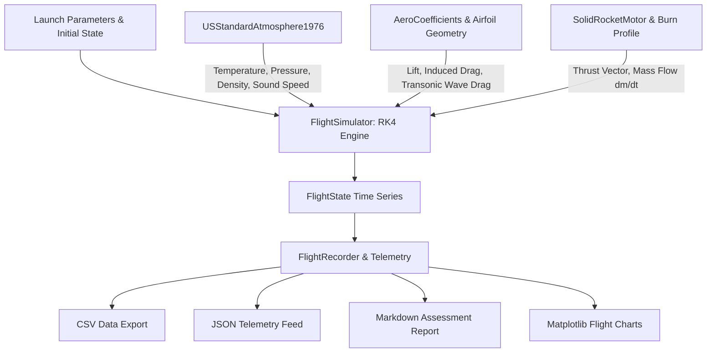

# aero-flight-dynamics

[](https://github.com/perfectalone375/aero-flight-dynamics/actions)
[](https://opensource.org/licenses/MIT)
[](https://www.python.org/downloads/)
[](https://github.com/psf/black)
[](tests/)

**`aero-flight-dynamics`** is an open-source, high-fidelity computational aerospace library in Python. It provides rigorous thermodynamic atmosphere models, compressible aerodynamics, solid rocket propulsion physics, 3-DoF Runge-Kutta 4th-order (RK4) trajectory integration, and automated flight telemetry analytics.

---

## Architecture Overview



---

## Core Capabilities

### 1. 1976 U.S. Standard Atmosphere Model
* Exact implementation of the 7-layer atmospheric model up to 86,000 meters geopotential altitude.
* Evaluates temperature lapse rates, hydrostatic pressure equations, density $\rho = P / (R \cdot T)$, speed of sound $a = \sqrt{\gamma R T}$, and dynamic viscosity $\mu$ via Sutherland's empirical formula.
* Asymptotic safe vacuum extension for orbital and space boundary altitudes.

### 2. Compressible Aerodynamics & Transonic Wave Drag
* **Airfoil Modeling:** NACA 4-digit parametric airfoil geometry generation (mean camber line, thickness distribution, theoretical lift curve slope, and zero-lift angle).
* **Compressibility Corrections:** Prandtl-Glauert subsonic compressibility correction:
  $$C_L = \frac{C_{L0}}{\sqrt{1 - M^2}}$$
* **Wave Drag Divergence:** Non-linear transonic drag rise modeling above critical Mach $M_{cr}$ via Lock/Korn formulations.
* **Induced Drag:** Finite-wing vortex-induced drag:
  $$C_{Di} = \frac{C_L^2}{\pi \cdot AR \cdot e}$$

### 3. Solid Rocket Propulsion
* Time-dependent grain burn profiles: `NEUTRAL`, `PROGRESSIVE`, `REGRESSIVE`, and `BOOST_SUSTAIN`.
* Dynamic mass depletion ($dm/dt$) and altitude-dependent specific impulse ($I_{sp}$) compensation between sea-level and vacuum nozzle expansion.

### 4. 3-DoF Numerical Trajectory Simulation (RK4)
* 4th-order Runge-Kutta numerical integration for stable, accurate trajectory prediction.
* Accounts for variable gravity gradient $g(z) = g_0 \left(\frac{R_E}{R_E + z}\right)^2$, aerodynamic lift and drag vectors, and vehicle mass loss.

### 5. AI Benchmark Task Suite (SWE-bench Standard)
* Includes complete scenario specifications under `benchmarks/` designed for frontier AI coding model evaluation.
* Features reproducible `Fail-to-Pass` regression tests and golden reference patch solutions.

---

## Quickstart

### Installation

Clone the repository and install in editable development mode:

```bash
git clone https://github.com/perfectalone375/aero-flight-dynamics.git
cd aero-flight-dynamics
python -m venv .venv
source .venv/bin/activate  # On Windows: .venv\Scripts\activate
pip install -e ".[dev]"
```

### Containerized Environment (Docker)

You can also run tests or execute simulations in a reproducible isolated container:

```bash
# Run complete test suite in Docker
docker compose run test

# Run trajectory simulation in Docker
docker compose run simulate
```

---

## Command Line Interface (CLI)

The package provides a built-in command-line tool `aeroflight`:

### 1. Query Atmospheric Conditions
```bash
python -m aero_flight_dynamics.cli atmosphere --altitude 12000
```
```text
============================================================
  U.S. STANDARD ATMOSPHERE (1976) AT 12,000.0 METERS
============================================================
  Geopotential Alt : 11,977.4 m
  Temperature      : 216.65 K (-56.50 deg C)
  Pressure         : 19,399.04 Pa (193.99 hPa)
  Density          : 0.31194 kg/m^3
  Speed of Sound   : 295.07 m/s
  Dynamic Visc.    : 1.4216e-05 Pa*s
============================================================
```

### 2. Analyze NACA Airfoil
```bash
python -m aero_flight_dynamics.cli airfoil --designation 2412 --alpha 5.0
```

### 3. Execute Suborbital Trajectory Simulation
```bash
python -m aero_flight_dynamics.cli simulate \
  --name "AeroProbe-1" \
  --elevation 85.0 \
  --dry-mass 35.0 \
  --propellant-mass 65.0 \
  --burn-time 8.0 \
  --isp 235.0 \
  --csv telemetry.csv \
  --json telemetry.json \
  --plot flight_profile.png
```

---

## Python API Usage

```python
from aero_flight_dynamics import (
    PointMassVehicle,
    SolidRocketMotor,
    MotorBurnProfile,
    AeroCoefficients,
    FlightSimulator,
    FlightRecorder,
)

# 1. Define propulsion system
motor = SolidRocketMotor(
    name="Composite Motor",
    dry_mass_kg=15.0,
    propellant_mass_kg=50.0,
    burn_time_s=7.0,
    isp_sea_level_s=230.0,
    isp_vacuum_s=260.0,
    profile=MotorBurnProfile.NEUTRAL,
)

# 2. Configure aerospace vehicle
vehicle = PointMassVehicle(
    name="Research Probe",
    structural_mass_kg=25.0,
    reference_area_m2=0.035,
    aerodynamics=AeroCoefficients(cd0=0.25, mach_critical=0.75),
    motor=motor,
)

# 3. Simulate flight
sim = FlightSimulator(vehicle=vehicle)
result = sim.simulate(launch_elevation_deg=85.0, dt=0.05)

# 4. Generate Telemetry Assessment
recorder = FlightRecorder(result)
print(recorder.generate_markdown_report())
```

---

## Automated Test Suite

Run the full unit and integration test suite:

```bash
pytest -v --cov=aero_flight_dynamics
```

```text
tests/test_aerodynamics.py ............                     [ 28%]
tests/test_atmosphere.py .............                      [ 61%]
tests/test_propulsion.py ............                       [ 80%]
tests/test_telemetry.py ............                        [ 85%]
tests/test_trajectory.py ...........                        [100%]

======================== 21 passed in 0.20s ========================
```

---

## License

This project is licensed under the **MIT License** - see the [LICENSE](LICENSE) file for details.

Developed by **Gopi Naga Vignesh Thirupati**.
